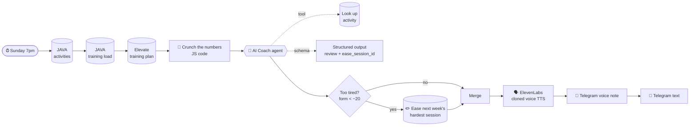

# 🏃 Sunday Coach: an AI marathon coach that talks to me in my own voice

Every Sunday at 7pm, an [n8n](https://n8n.io) workflow reviews my week of marathon training, **adjusts next week's plan if I'm overcooked**, and sends a **60-second voice note to my phone on Telegram, spoken in my own cloned voice** (ElevenLabs).

I'm training for **London Marathon 2027 with a target of 2:40 (6:06/mile)**. This replaces the Sunday-night spreadsheet session with a coach that reads the data, makes a call, and tells me about it while I'm making dinner.

> This is a working automation I use every week, not a demo. It shows an AI agent with tools and structured output, guarded write-back to a live database, and voice synthesis delivered on mobile, all in one workflow.

---

## What it does



| # | Stage | What happens |
|---|-------|--------------|
| 1 | **Collect** | Pulls the last 7 days of activities and the latest fitness/fatigue/form snapshot from **JAVA** (my training log app), plus this week's and next week's sessions from **Elevate** (my training plan app). Both apps run on **Supabase**. |
| 2 | **Analyse** | A Code node works out weekly run miles, longest run, miles at or faster than marathon pace, **actual vs planned mileage**, and training load. Turning the raw data into a small summary before the model sees it keeps the prompt short and the output reliable. |
| 3 | **Coach** | An **AI Agent** (LangChain agent in n8n) acting as an experienced marathon coach writes a review of 150 words or fewer: what went well, one thing to watch, one change for next week. It can **call a tool** to look up any unusual session in detail. A **structured output parser** makes it return clean JSON (`review` and `ease_session_id`). |
| 4 | **Adjust** | If the AI picks a session to ease **and** my form really is below the threshold, the workflow **writes back to the training plan**: the hardest session becomes an easy run at 70% of the distance, tagged *"eased by Sunday Coach"*. |
| 5 | **Deliver** | The review goes to **ElevenLabs text-to-speech using a clone of my own voice**, and the MP3 is sent to my phone as a **Telegram** audio message, followed by the text version. |

## Tech stack

| Tool | Role |
|------|------|
| **n8n** | Orchestration, scheduling, branching |
| **OpenAI (GPT-5.4 mini)** via n8n AI Agent | Coaching review and decision on which session to ease |
| **ElevenLabs** (voice clone, `eleven_multilingual_v2` model) | Turns the review into speech in *my* voice |
| **Telegram Bot API** | Push delivery to my phone |
| **Supabase** (Postgres) | Data for my two apps: JAVA (training log) and Elevate (training plan) |
| **JavaScript** | Data shaping and pace/mileage maths |

## AI design decisions worth calling out

- **The AI advises, the rules decide.** The model suggests which session to ease, but the write to the database only happens if a hard-coded check also passes (`form < −20`). A hallucinated or over-cautious answer can't change my plan on its own.
- **Structured output instead of free text.** A JSON schema output parser means the next steps get a known shape (`review`, `ease_session_id`) instead of having to parse prose.
- **Tool use only when needed.** The agent gets a summary by default and can pull full detail on a single activity through a Supabase tool. That keeps token use low without hiding information from it.
- **Pre-computed numbers.** Pace and mileage maths happen in code, not in the LLM, so the figures in the voice note are correct.
- **Written for listening.** The prompt limits the review to 150 words with a fixed structure, so the voice note lands at about 60 seconds.

## Run it yourself

1. In n8n: **Workflows → Import from file** → [`workflows/sunday-coach.json`](workflows/sunday-coach.json).
2. Create credentials and attach them to the nodes:
   - **Supabase** (OAuth2 or API key)
   - **OpenAI** for the Chat model node
   - **ElevenLabs** as a Custom Auth credential sending header `xi-api-key: <your key>`
   - **Telegram** bot token from [@BotFather](https://t.me/BotFather)
3. Replace the placeholders:

   | Placeholder | Where to get it |
   |-------------|-----------------|
   | `YOUR_SUPABASE_PROJECT_1` / `_2` | Supabase project ref (activities DB / plan DB) |
   | `YOUR_ATHLETE_ID` | Your athlete row in the plan DB |
   | `YOUR_ELEVENLABS_VOICE_ID` | ElevenLabs → Voices → your cloned voice → ID |
   | `YOUR_TELEGRAM_CHAT_ID` | Message your bot, then check `getUpdates` |

4. Change `FORM_THRESHOLD` and `MARATHON_PACE_SEC` at the top of **Crunch the numbers** to suit your own goal.

The Supabase table schemas belong to my own apps. To use a different source (Strava, Garmin, a spreadsheet), swap the three Collect nodes and keep the field names the Code node expects.

## Repo layout

```
workflows/sunday-coach.json   # sanitised n8n export
scripts/sanitize.js           # strips IDs, chat IDs and project refs before publishing
```

Personal identifiers (chat IDs, project refs, credential IDs, voice ID) are removed by `scripts/sanitize.js` before publishing. To re-export after changes: download the workflow from n8n, then run `node scripts/sanitize.js export.json > workflows/sunday-coach.json`.
